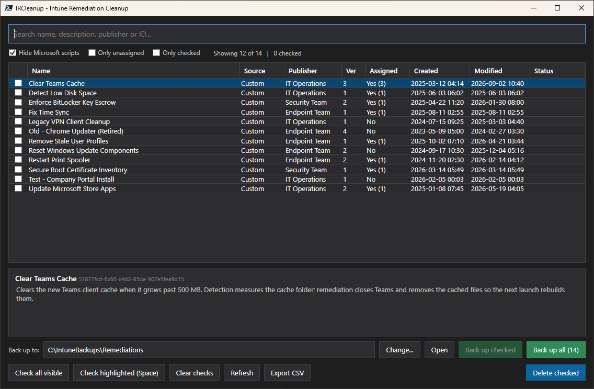
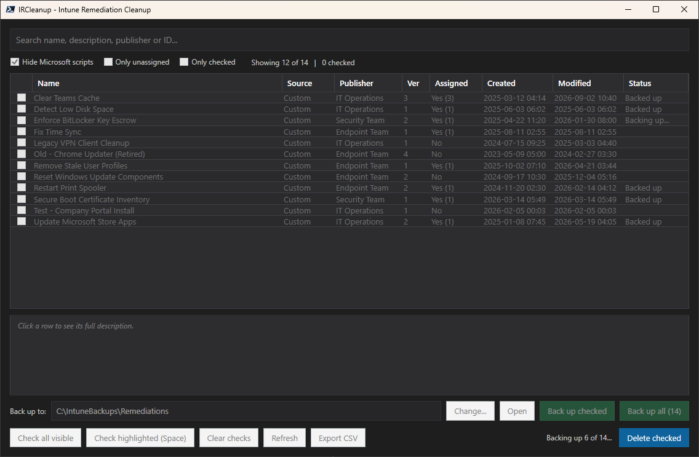
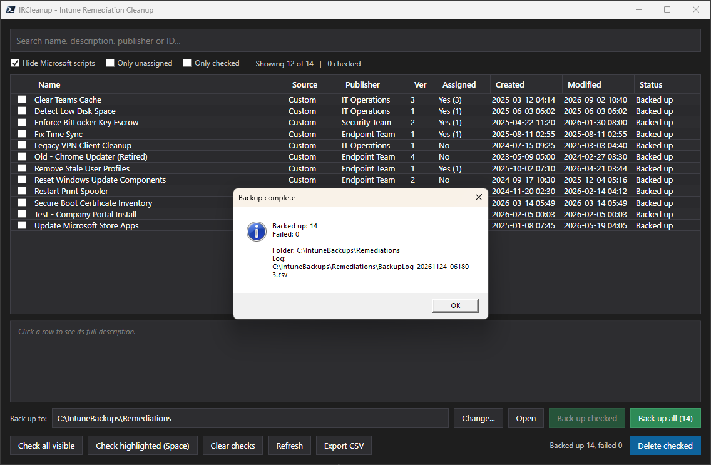
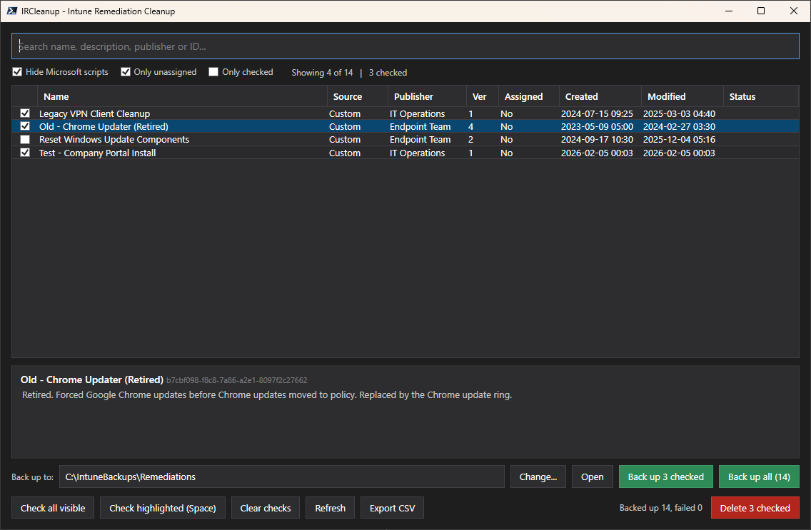
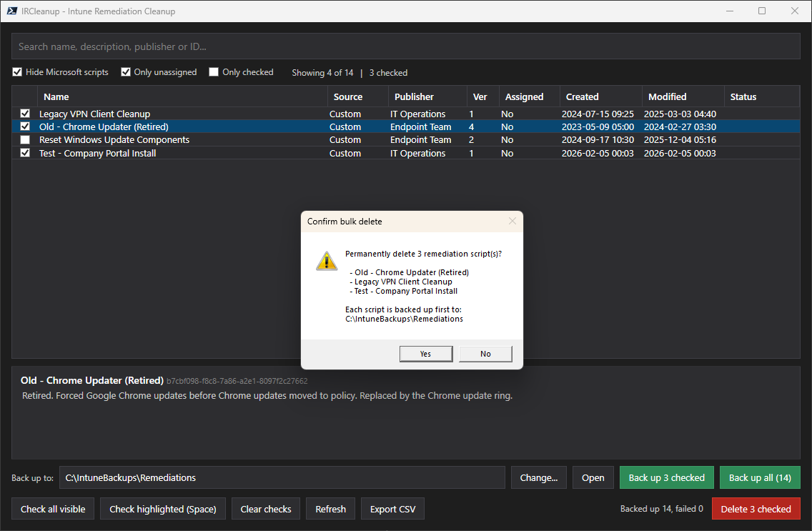
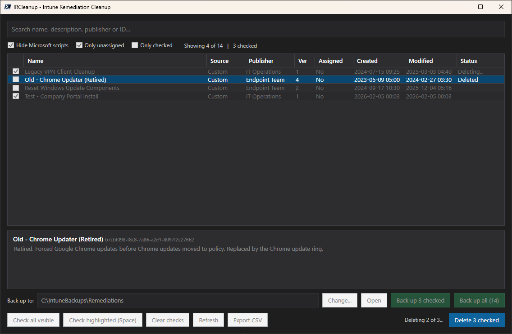
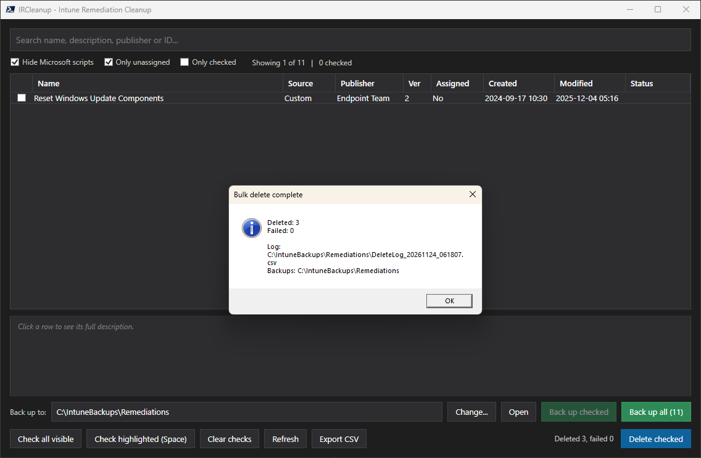

# IRCleanup – Intune Remediation Cleanup

IRCleanup is a PowerShell tool with a Windows interface for keeping Intune Remediation scripts under control. It signs in to Microsoft Graph and lists every remediation in your tenant in one searchable grid, showing who published each script, its version, whether it's assigned, and when it was created and last changed. You can back up the scripts you've checked, or every script at once, then delete the ones you no longer need. Each script is backed up automatically before it's deleted.



## Features

- **Search, filter and sort.** Every search term must match the name, description, publisher or ID. You can hide Microsoft's built-in scripts, show only unassigned scripts, or show only checked ones, and export the current view to CSV.
- **Back up checked or Back up all.** Each script is saved to its own folder, named after the script. The folder holds the detection and remediation scripts, the full Graph definition, its settings, and its assignments with group names.
- **Bulk delete.** Checked scripts are deleted in one go. Each is backed up first, and if its backup fails it isn't deleted. Microsoft's built-in scripts can't be checked or deleted.
- **Logs.** Every backup and delete run writes a CSV log that includes each script's description, so you have a record of what was removed and what it did.
- **Remembers your backup folder.** Use a local path or a network share. It's remembered between runs.
- **Runs on Windows PowerShell 5.1 and PowerShell 7,** in a dark or light theme.

## Requirements

- Windows with Windows PowerShell 5.1 or PowerShell 7.
- The `Microsoft.Graph.Authentication` module. If it's missing, IRCleanup installs it for the current user. No other Graph modules are needed.
- An account with an Intune role that can read remediations and, to delete, delete them (the **Device configurations** permissions).
- The Microsoft Graph permissions below, with admin consent.

## Microsoft Graph permissions

IRCleanup uses two delegated Microsoft Graph permissions:

| Permission | Required? | Used for |
|---|---|---|
| `DeviceManagementConfiguration.ReadWrite.All` | Required | Listing, backing up and deleting remediation scripts |
| `GroupMember.Read.All` | Optional | Looking up group names, so `assignments.txt` shows "Pilot Devices" instead of a group ID |

IRCleanup asks for both permissions when you sign in. If `GroupMember.Read.All` can't be granted, for example because admin consent hasn't been given, it signs in again with only the required permission. Everything still works, but `assignments.txt` lists group IDs instead of names. Assignment filter names are always shown, because they don't need the extra permission.

If either permission is missing from the access token, the console shows a warning. Without `DeviceManagementConfiguration.ReadWrite.All`, deletes will fail. Without a group permission, group names won't be shown.

Sign-in is interactive (delegated). By default IRCleanup uses the Microsoft Graph PowerShell app. To use your own app registration, pass `-ClientId` and `-TenantId`. App-only sign-in, with a certificate or client secret, isn't supported.

## Getting started

```powershell
git clone https://github.com/markorr321/intune-remediation-cleanup.git
cd intune-remediation-cleanup
.\IRCleanup.ps1
```

If you downloaded the script instead of cloning it, run `Unblock-File .\IRCleanup.ps1` first, or PowerShell may refuse to run it.

A browser window opens for sign-in. Once you're signed in, the grid loads with every remediation script in the tenant.

### Parameters

| Parameter | Description |
|---|---|
| `-ClientId` | App registration client ID. If omitted, the Microsoft Graph PowerShell app is used. |
| `-TenantId` | Tenant ID. If omitted, you sign in to your account's home tenant. |
| `-BackupPath` | Backup folder for this run (local path or network share). Overrides the remembered folder without changing it. |
| `-NoBackup` | Skip the automatic backup before deleting. Not recommended. The backup buttons still work. |
| `-Theme` | `Dark` (default) or `Light`. |

### Examples

```powershell
# Open the grid, backing up to the remembered folder (or %APPDATA%\IRCleanup\Backups)
.\IRCleanup.ps1

# Back up to a network share for this run, using the light theme
.\IRCleanup.ps1 -BackupPath '\\fileserver\IT\IntuneBackups' -Theme Light
```

## Walkthrough

### 1. Back up everything

Set the backup folder in the **Back up to** bar, or choose one with **Change...**, then click **Back up all**. Each row's Status column shows its progress.



When it finishes, a summary shows how many scripts were backed up and where the log was saved.



### 2. Pick what to remove

Use the filters to narrow the list. Here, **Only unassigned** is on and three retired scripts are checked. The buttons show how many scripts are checked. To check a range quickly, click the first row, Shift-click the last, then press **Space**.



### 3. Delete

Click **Delete N checked**. IRCleanup lists the scripts it's about to delete, warns you if any are still assigned, and shows where it'll back them up.



Each script is backed up and then deleted. If a script's backup fails, it isn't deleted.



Deleted scripts are removed from the grid, and a summary shows the results and the log location.



## What a backup contains

Each script gets its own folder, named after the script:

```
C:\IntuneBackups\Remediations\
├── Clear Teams Cache\
│   ├── script.json        Full Graph definition, including assignments
│   ├── settings.txt       The portal's Settings section
│   ├── assignments.txt    Included and excluded groups by name, with schedule and filter
│   ├── detect.ps1         Detection script
│   └── remediate.ps1      Remediation script, if the script has one
├── Restart Print Spooler\
│   └── ...
├── BackupLog_20261124_061803.csv
└── DeleteLog_20261124_061807.csv
```

**assignments.txt**

```
Clear Teams Cache
=================

Assignments
-----------
Included
  Pilot Devices
    Group ID:  7db072ee-8a1a-2ecc-fffe-aaec11d4a5b4
    Schedule:  Every day at 18:00 (device local time)
    Filter:    None
  All Windows Devices
    Group ID:  ab5e567f-d743-2295-2832-91a170c0a65b
    Schedule:  Every day at 12:00 (device local time)
    Filter:    Include - Windows 11 only

Excluded
  Kiosk Devices
    Group ID:  8c5a2557-5202-e93b-f2a4-4f92ec1dea8e
```

**settings.txt**

```
Clear Teams Cache
=================

Settings
--------
Detection script                                   Yes
Remediation script                                 Yes
Run this script using the logged-on credentials    No
Enforce script signature check                     No
Run script in 64-bit PowerShell                    Yes
```

**How backups are named and logged:**

- **Duplicate names:** two scripts can share a name. The second one is saved to `<script name> (2)`, so neither overwrites the other.
- **Backing up again:** backing up the same script again overwrites its folder with the current version. To keep a point-in-time copy, back up to a different folder.
- **Logs:** `BackupLog_<timestamp>.csv` and `DeleteLog_<timestamp>.csv` record the result, name, description and ID of every script in the run.
- **Recreating a script:** there's no restore button. `script.json` holds the full definition, including the detection and remediation content (Base64-encoded), every setting and the assignments, so you can recreate a deleted script from it.

## Notes

- **Multi Admin Approval.** If an Intune Multi Admin Approval access policy covers scripts, deletes fail with `Header 'x-msft-approval-justification' is required`. The backup is still taken. Delegated sign-in is always subject to Multi Admin Approval, so the delete needs approval from a second admin.
- **Where settings are stored.** The remembered backup folder is saved in `%APPDATA%\IRCleanup\settings.json`. The default backup folder is `%APPDATA%\IRCleanup\Backups`.
- **Graph endpoint.** IRCleanup calls the Microsoft Graph **beta** endpoint (`deviceManagement/deviceHealthScripts`), which is where Intune remediations are exposed.

The screenshots in this README use fictional demo data.
